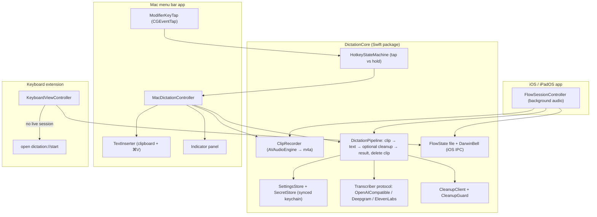
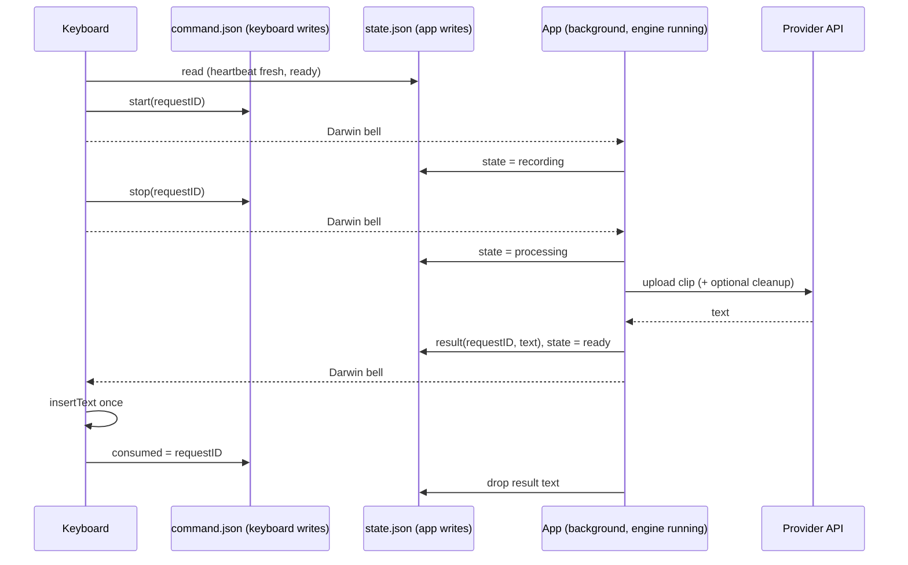
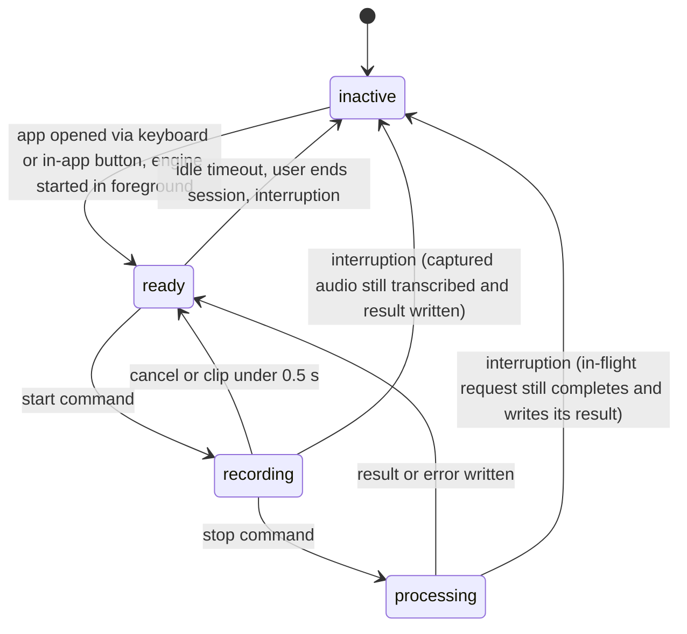
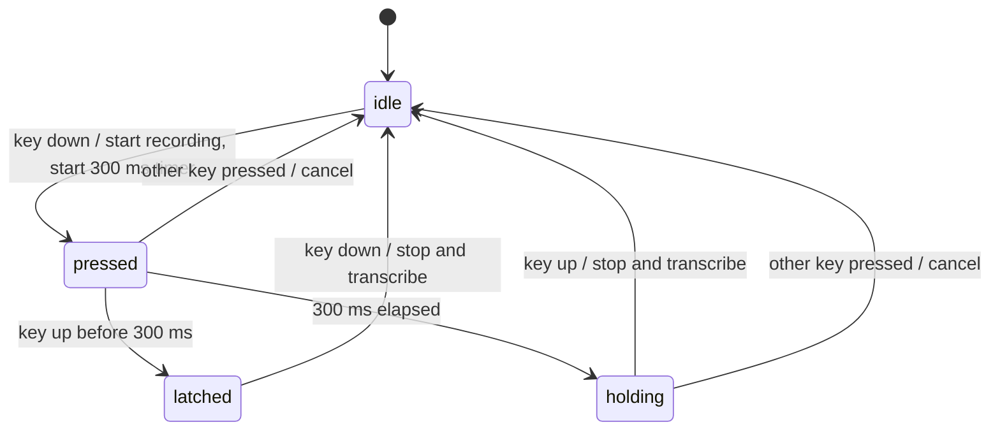

# Personal BYO-Key Dictation App - Plan

## Goal Capsule

- **Objective:** Robert can dictate accurately into any app on his Mac, iPhone, and iPad without a subscription, paying only per-use provider fees on his own API keys and switching models whenever he likes.
- **Means:** One native Swift/SwiftUI codebase. It has a shared Swift package for the provider, cleanup, and settings logic, plus three targets: a macOS menu bar app, an iOS/iPadOS app, and an iOS custom keyboard extension.
- **Authority:** Product Contract requirements win on behavior. Key Technical Decisions win on mechanism. Units cite both and override neither.
- **Stop conditions:** Stop and report if the U7 on-device spike shows either of two things: iOS cannot keep a background recording session ready for the keyboard, or the keyboard cannot open the app on Robert's iOS version. Either would invalidate R7, so ask before redesigning the iOS flow.
- **Execution profile:** This is greenfield work. It must be built and run on a Mac with Xcode 26 and a real iPhone or iPad, because a Linux orb cannot build or run Apple targets. Package logic is unit-tested. Everything that touches devices is verified with the manual smoke checks in the Verification Contract.
- **Who finishes:** Robert installs the apps on his own devices with his paid Apple Developer account. Nothing is published.

---

## Product Contract

### Summary

Build a personal Monologue/Wispr Flow replacement:
- **Mac:** a menu bar app with a single-modifier hotkey that pastes the transcript at the cursor.
- **iPhone/iPad:** a custom keyboard that inserts the transcript into any app, backed by the main app recording in the background.
- **Transcription:** batch, English, through the user's choice of OpenAI-compatible, Deepgram, or ElevenLabs Scribe.
- **Cleanup:** an optional LLM pass.
- **Sync:** keys and preferences sync through iCloud Keychain.

### Problem Frame

Robert pays a monthly subscription for Monologue but uses one feature: accurate voice-to-text wherever he types. The transcription models behind these products are available directly from providers, usually for cents an hour, and better ones keep appearing. He wants to own the app so his cost tracks usage and he can switch to whichever model is most accurate. The app does not need to be fancy. Accuracy and reliability in any text field matter most.

### Requirements

**Mac dictation**

- R1. A global hotkey works in any app. It is a single modifier key chosen in settings from Fn/Globe, Right Option, Right Command, and Right Control.
- R2. The same key supports both modes. A quick tap starts recording and the next tap stops it. Holding the key past a short threshold records until release.
- R3. After recording stops, the final text is pasted at the current cursor and the clipboard is restored to its previous contents.
- R4. A small floating indicator shows recording, transcribing, and error states.
- R5. First run walks through the Microphone and Accessibility permissions. When Fn/Globe is chosen, it also tells the user to set "Press 🌐 key to" to "Do Nothing".

**iPhone/iPad dictation**

- R6. A custom keyboard extension inserts dictated text into any app's text field. Without Full Access, it shows how to enable it instead of a mic button.
- R7. If no recording session is active, tapping the keyboard's mic opens the main app. The app starts the session and shows a "swipe back" screen. While the session is active, mic taps in the keyboard start and stop recording without leaving the current app.
- R8. The session ends after an idle timeout (default 5 minutes, configurable), when the user ends it in the app, or when the system interrupts audio. The next mic tap then falls back to R7's open-the-app path.
- R9. The keyboard is minimal: a mic button, a next-keyboard (globe) key, space, delete, return, and a status line. Full typing happens on the system keyboard.

**Transcription and cleanup**

- R10. The user picks one transcription provider and model: OpenAI-compatible (base URL, key, model), Deepgram, or ElevenLabs Scribe. Each provider has a sensible default model the user can edit.
- R11. Transcription is batch: the whole clip uploads after recording stops. It is English only.
- R12. An optional cleanup pass, off by default, sends the transcript to an OpenAI-compatible chat endpoint (base URL, key, model) with one editable prompt. The default prompt removes filler words and fixes punctuation while keeping the user's wording.
- R13. Cleanup never replaces the dictation with an answer to it. If the cleaned text fails a sanity check, or the cleanup call fails, the raw transcript is used.

**Settings, privacy, and failure**

- R14. API keys and preferences sync across Mac, iPhone, and iPad through iCloud, so they are entered once.
- R15. No transcript history and no saved audio. Each clip is deleted as soon as its request finishes, whether it succeeded or failed.
- R16. When transcription fails, the user sees a clear error naming the cause (bad key, out of credits, rate limited, network, provider error). Nothing is pasted or inserted, and the clipboard is unchanged.

### Success Criteria

- Dictating a paragraph into Notes, Mail, Slack, a browser text field, and a terminal produces the same text the provider returns, with no manual copy-paste, on every device.
- Switching provider or model on one device takes effect on the others without re-entering keys.
- A warm iOS dictation (session already active) needs no app switch: tap mic, speak, tap mic, and the text appears.

### Scope Boundaries

- No on-device models, streaming or live text, custom vocabulary, multiple languages, transcript history, saved audio, or retry.
- No meeting notes, voice notes, Apple Watch app, MCP/API/CLI access, or App Store release.
- No full QWERTY keyboard; the custom keyboard is dictation-first (R9).
- No native Anthropic client. Claude models are reachable through OpenRouter's OpenAI-compatible endpoint.
- No automatic return to the previous iOS app. iOS has no public API for it, and the private host-bundle trick stopped working in iOS 26.4.
- No Control Center / Action Button / Shortcut trigger. The user rarely uses an iPad hardware keyboard, which is the case that hides custom keyboards.
- Considered and not built:
  - **Recording length cap:** a forgotten toggle only costs cents, and at about 0.25 MB per minute the clip would need over an hour to approach the 25 MB OpenAI limit. Revisit if accidental long recordings happen.
  - **Automatic retry on 429/5xx:** the user chose "say it again" over retry, and audio is not kept.
  - **WAV upload option for whisper.cpp servers:** whisper.cpp accepts m4a when started with `--convert`. Revisit if a self-hosted server must be used without it.
  - **Mirroring settings into the keyboard:** the keyboard never needs keys or preferences, because the app does all the work (KTD4).

#### Deferred to Follow-Up Work

- A Control Center / Action Button trigger using `AudioRecordingIntent`, if the keyboard flow proves too slow on iPhone.
- Streaming transcription, if batch latency is annoying in practice.

---

## Planning Contract

### Key Technical Decisions

- KTD1. **Native Swift 6 / SwiftUI with one shared package (`DictationCore`), three app targets, and a Mac unit-test target, all generated by XcodeGen from `project.yml`.** Logic worth unit-testing lives in the package, so the app targets stay thin. Only native code can register a global modifier-key tap on macOS and ship an iOS keyboard extension. XcodeGen keeps the project definition reviewable text instead of a hand-merged `.pbxproj`. Minimum OS: macOS 15, iOS/iPadOS 18, which the keyboard's app-open path requires.
- KTD2. **Mac hotkey is a custom `CGEventTap`, not KeyboardShortcuts or Carbon hotkeys.** Those APIs cannot register a modifier-only key and refuse Fn. VoiceInk took the same path. Details:
  - It is a session-level tap created with the default (active) option, which needs only the Accessibility permission already required for pasting.
  - It never swallows events.
  - It watches flag changes, key downs, and other-mouse downs. Key downs are needed for the chord-cancel rule in KTD3.
  - Fn/Globe is detected with `maskSecondaryFn`, and the right-side modifiers by keycode: Right Option 61, Right Command 54, Right Control 62.
  - It re-enables itself when macOS disables it on timeout or user input.
- KTD3. **Tap-versus-hold is one pure state machine with a 300 ms threshold.** Key down always starts recording, so hold-to-talk loses no speech. Key up before 300 ms latches toggle mode, and the next key down stops. Key up after 300 ms stops. A modifier pressed together with another key (for example Right Option + a letter) cancels the recording silently, so normal shortcuts keep working.
- KTD4. **On iOS the main app owns the microphone, the network, the API keys, and cleanup. The keyboard only signals and inserts.** Keyboard extensions cannot use the mic, and keeping keys and network in the app keeps the extension under its roughly 40 MB memory budget. The keyboard still needs Full Access to write to the shared container and to open the app on iOS 26.
- KTD5. **The iOS session starts the audio engine in the foreground and keeps it running. "Start" from the keyboard only begins writing buffers to a file.** A backgrounded app cannot activate a record session (`cannotStartRecording`). The orange mic indicator therefore stays on while the session is active, and the idle timeout (R8) limits the battery cost.
- KTD6. **Keyboard and app communicate through two small JSON files in the App Group container, each with exactly one writer, plus Darwin notifications as a doorbell.** One writer per file means the app's once-a-second heartbeat can never overwrite a keyboard command, and atomic replace is enough with no file coordination.
  - **`command.json`, written only by the keyboard:** the pending command (start, stop, or cancel), its request ID, whether that request was abandoned because the keyboard disappeared, and the last result ID the keyboard consumed.
  - **`state.json`, written only by the app:** session state, a heartbeat timestamp updated every second while the session is active, and the latest result or error with its request ID.
  - **Missed notifications:** Darwin notifications carry no payload and can be lost, so the keyboard also re-reads both files in `viewWillAppear` and polls while it waits for a result.
  - **Dead session:** a heartbeat older than 2 s means the session is dead, and the next mic tap opens the app. A request already pending is the exception: the keyboard keeps waiting for that request ID's result even after the heartbeat goes stale, because an interrupted session still delivers it (U7).
  - **Exactly once:** results carry the request ID the keyboard issued and are inserted once. Once the app sees the consumed ID, it removes that result's text from `state.json`. Ending the session clears any unconsumed result, so no dictated text stays on disk (R15).
- KTD7. **Keys and preferences sync as two synchronizable keychain items in one shared access group, not as iCloud key-value storage.** One holds a dictionary of API keys and the other holds a JSON preferences blob. Apple's documentation conflicts on whether `NSUbiquitousKeyValueStore` works for a Developer ID Mac app, while keychain sharing is supported there. Rules:
  - On the Mac every keychain call sets `kSecUseDataProtectionKeychain`.
  - There is no change notification, so settings are re-read when an app becomes active and before each dictation.
  - Each item holds a whole blob and the newest write wins across devices. So a device writes only after an explicit user edit: it re-reads the current item, changes just the edited entry, and keeps any JSON keys it doesn't recognize. Defaults stay in memory and are never written. A fresh install or an older build therefore cannot wipe settings made elsewhere.
  - **Keys are tied to role and host:** `transcription:<base-URL host>` or `cleanup:<base-URL host>`. A client looks up the key for the host it is about to call, so switching the OpenAI-compatible preset or editing the base URL never sends one provider's key to another host.
- KTD8. **Mac text insertion uses the clipboard plus a synthesized ⌘V, following VoiceInk.** The steps:
  1. Snapshot every pasteboard item and type.
  2. Write the text marked `org.nspasteboard.TransientType` so clipboard managers skip it.
  3. Post ⌘V.
  4. After about 1.5 s, restore the snapshot, but only if the pasteboard change count still matches what was written.
  If Accessibility trust is missing, the text stays on the clipboard and the indicator says "Copied, press ⌘V".
- KTD9. **Audio is recorded as AAC-LC `.m4a`, mono, 16 kHz, about 32 kbps, by one shared `ClipRecorder` built on `AVAudioEngine`.** It has two separate lifetimes:
  - The engine lifetime (start engine, stop engine) owns the input tap and the 16 kHz conversion.
  - The clip lifetime (begin clip, end clip) only opens and closes the file that buffers are written to.
  The Mac runs both together for each dictation. iOS keeps the engine running for the whole session and only begins and ends clips (KTD5). Every provider accepts this format. A few minutes is well under every size limit, so no chunking is needed. Clips shorter than 0.5 s are discarded without upload, because transcription models invent text ("Thank you.") on near-silence.
- KTD10. **Provider clients use plain `URLSession` with no SDKs, behind one `Transcriber` protocol.** Each client builds its request and parses its own success and error bodies into one `DictationError` type. Request rules (verified Oct 2026):
  - **OpenAI-compatible:** `POST {baseURL}/audio/transcriptions`, multipart `file` (named `*.m4a`) and `model`. Read `.text`. Send `languages[]=en` when the model name starts with `gpt-transcribe`, and `language=en` for every other model. `gpt-transcribe` rejects the singular field, and Whisper models left to auto-detect can mistake short English clips for another language. The key may be empty for local servers. Presets: OpenAI (`https://api.openai.com/v1`, `gpt-transcribe`) and Groq (`https://api.groq.com/openai/v1`, `whisper-large-v3-turbo`). OpenAI shuts down `whisper-1` and `gpt-4o-*-transcribe` on 2027-02-26, so they are not used as defaults.
  - **Deepgram:** `POST https://api.deepgram.com/v1/listen?model=nova-3&smart_format=true&language=en`, `Authorization: Token <key>`, raw bytes with `Content-Type: audio/mp4`. Read `results.channels[0].alternatives[0].transcript`. The `model` parameter is always sent, because omitting it falls back to the weak `base` model.
  - **ElevenLabs:** `POST https://api.elevenlabs.io/v1/speech-to-text`, `xi-api-key`, multipart `file` with `model_id=scribe_v2`, `language_code=en`, and `tag_audio_events=false`. Read `.text`. `scribe_v1` was removed on 2026-07-09.
- KTD11. **Cleanup prompt and guard.** The system message holds the rules and a few examples where instruction-like dictation comes back only cleaned. The transcript goes in the user message inside a tag with a random per-request suffix, so dictated text cannot close the tag. Prompts alone are not a reliable boundary, so code checks the output. The raw transcript is used instead when the output is more than 1.5× the input's length plus 20 characters, or when fewer than 60% of the input's words appear in it.
- KTD12. **The Mac app is signed with the Apple Development identity during development and with Developer ID (including its provisioning profile) for daily use.** App Sandbox is off and Hardened Runtime is on, with the audio-input entitlement. A stable signing identity keeps macOS from dropping the Accessibility grant on every rebuild. The provisioning profile is required for the keychain access group.

### High-Level Technical Design

Component layout:



iOS warm dictation sequence:



iOS session states, owned by the app:



Mac hotkey state machine (KTD3):



### Output Structure

```text
dictation/
  project.yml
  Packages/DictationCore/
    Package.swift
    Sources/DictationCore/
      Settings/        (AppPreferences, SecretStore, SettingsStore)
      Audio/           (ClipRecorder)
      Transcription/   (Transcriber, OpenAICompatibleTranscriber, DeepgramTranscriber, ElevenLabsTranscriber, Multipart)
      Cleanup/         (CleanupClient, CleanupGuard, DefaultCleanupPrompt)
      Pipeline/        (DictationPipeline, DictationError)
      Flow/            (FlowCommand, FlowState, FlowFiles, DarwinBell, FlowSessionPolicy, KeyboardResultSelector)
      Hotkey/          (HotkeyStateMachine)
    Sources/DictationUI/  (shared SwiftUI SettingsView)
    Tests/DictationCoreTests/
      Fixtures/        (short.m4a, provider response and error JSON)
  Apps/Mac/            (DictationMacApp, MacDictationController, ModifierKeyTap, TextInserter, IndicatorPanel, OnboardingView, Info.plist, Mac.entitlements)
  Apps/MacTests/       (TextInserterTests)
  Apps/iOS/            (DictationiOSApp, FlowSessionController, SwipeBackView, Info.plist, iOS.entitlements)
  Apps/Keyboard/       (KeyboardViewController, KeyboardView, Info.plist, Keyboard.entitlements)
  docs/plans/
  README.md
```

---

## Implementation Units

### U1. Project scaffolding and entitlements

- **Goal:** All three targets build from one XcodeGen spec and launch on device with the right capabilities.
- **Requirements:** R14 (entitlements), KTD1, KTD12.
- **Dependencies:** none.
- **Files:** `project.yml`, `Packages/DictationCore/Package.swift`, `Apps/Mac/Info.plist`, `Apps/Mac/Mac.entitlements`, `Apps/iOS/Info.plist`, `Apps/iOS/iOS.entitlements`, `Apps/Keyboard/Info.plist`, `Apps/Keyboard/Keyboard.entitlements`, `README.md`, `.gitignore`.
- **Approach:**
  1. Bundle IDs under one prefix, for example `com.robertguss.dictation`, `.mac`, `.ios`, `.ios.keyboard`. The team ID is set once in `project.yml`.
  2. Mac: `LSUIElement`, Hardened Runtime, no sandbox, `com.apple.security.device.audio-input`, `NSMicrophoneUsageDescription`, and `keychain-access-groups`.
  3. iOS app: `UIBackgroundModes` = `audio`, the `dictation` URL scheme, `NSMicrophoneUsageDescription`, the App Group, and `keychain-access-groups`.
  4. Keyboard: `RequestsOpenAccess = YES`, the same App Group, and `PrimaryLanguage` `en-US`.
  5. A `MacTests` unit-test target hosted by the Mac app, with sources in `Apps/MacTests/`, wired into the Mac scheme's test action.
  6. README covers `xcodegen generate`, signing setup, Developer ID export for the Mac, and enabling the keyboard plus Full Access on iOS.
- **Execution note:** This is packaging. Prove it by installing and launching each target on a device, not with unit tests.
- **Test expectation:** none, scaffolding only.
- **Verification:** `xcodegen generate` succeeds. The Mac app shows a menu bar icon. The iOS app launches and the keyboard can be added in Settings.

### U2. Transcription providers

- **Goal:** One `Transcriber` interface that turns an m4a clip into text through any of the three providers, with typed errors.
- **Requirements:** R10, R11, R16, KTD10.
- **Dependencies:** U1.
- **Files:** `Packages/DictationCore/Sources/DictationCore/Transcription/*`, `Packages/DictationCore/Sources/DictationCore/Pipeline/DictationError.swift`, `Packages/DictationCore/Tests/DictationCoreTests/TranscriberTests.swift`, `Packages/DictationCore/Tests/DictationCoreTests/Fixtures/*`.
- **Approach:**
  - A request builder and a response parser per provider, tested through a `URLProtocol` stub. No live calls in unit tests.
  - Error mapping: any 402, an ElevenLabs 401 whose body has `detail.status` = `quota_exceeded`, and an OpenAI 429 with `insufficient_quota`-family codes → out of credits. Other 401/403 → invalid key. Other 429 → rate limited. 413 → too large. 5xx → provider error. URL errors → network. Request timeout 60 s.
  - Show the provider's own message string alongside the mapped cause.
  - Trim surrounding whitespace from the transcript. An empty transcript is an error ("No speech detected"), not an empty paste.
- **Test scenarios:**
  - The OpenAI-compatible request posts to `{base}/audio/transcriptions`, works with base URLs with or without a trailing slash, and carries multipart `file` with an `.m4a` filename and `model`.
  - With model `gpt-transcribe` the request carries `languages[]=en` and no `language`. With `whisper-large-v3-turbo` it carries `language=en` and no `languages[]`.
  - The OpenAI-compatible request with an empty key sends no `Authorization` header.
  - The Deepgram request carries `model=nova-3` (or the user's model), `smart_format=true`, `language=en`, the `Token` auth scheme, and a raw body with `audio/mp4`.
  - The ElevenLabs request carries `model_id`, `tag_audio_events=false`, `language_code=en`, and the `xi-api-key` header.
  - A fixture success body for each provider parses to the expected text.
  - OpenAI 429 with `insufficient_quota` maps to out of credits, while 429 with `rate_limit_exceeded` maps to rate limited.
  - Deepgram 402 maps to out of credits. ElevenLabs 401 with `quota_exceeded` maps to out of credits, and ElevenLabs 401 with `invalid_api_key` maps to invalid key.
  - A 200 response whose transcript is whitespace-only yields "No speech detected".
  - A non-JSON 502 body maps to provider error without crashing.
- **Verification:** Package tests pass. A manual call with a real key per provider (U5 or U7 smoke) returns text for `Fixtures/short.m4a`.

### U3. Synced settings and secrets

- **Goal:** Keys and preferences saved on one device appear on the others. One shared settings screen edits them.
- **Requirements:** R10, R12, R14, KTD7.
- **Dependencies:** U1.
- **Files:** `Packages/DictationCore/Sources/DictationCore/Settings/*`, `Packages/DictationCore/Sources/DictationUI/SettingsView.swift`, `Packages/DictationCore/Tests/DictationCoreTests/SettingsStoreTests.swift`.
- **Approach:**
  - `SecretStore` wraps SecItem calls on one synchronizable generic-password item in the shared access group, with `kSecUseDataProtectionKeychain` on macOS. The item holds a dictionary keyed by role and host (KTD7), and it covers the cleanup key as well.
  - `SettingsStore` keeps the preferences in the second synchronizable item. `AppPreferences` holds the selected provider, per-provider base URL and model, cleanup enabled, the cleanup base URL and model, the cleanup prompt, the Mac hotkey choice, and the iOS idle timeout (2, 5, or 15 minutes, default 5).
  - Both stores follow KTD7's write rules: write only on an explicit edit, re-read and change one entry, keep unknown JSON keys, and never persist defaults.
  - `SettingsView` shows only the fields for the selected provider, has a "Reset prompt to default" action, and puts the hotkey and idle-timeout pickers in platform sections.
- **Test scenarios:**
  - Preferences encode and decode round-trip.
  - Decoding a blob missing newer fields yields defaults for those fields and keeps the rest.
  - Decoding a blob with an unknown provider ID falls back to the default provider without throwing.
  - Editing one preference on a blob that contains an unknown key `futureField` writes back a blob that still contains `futureField`.
  - Reading settings when no keychain item exists returns defaults and writes nothing.
  - After a key is saved for `api.openai.com`, changing the OpenAI-compatible base URL to `api.groq.com` returns no key, and the client sends no `Authorization` header.
  - `SecretStore` stores, reads, overwrites, and deletes a key through a protocol-backed in-memory fake used by the other tests. The real keychain is checked in device smoke only.
- **Verification:** On device, a key entered on the Mac appears in the iOS settings screen after iCloud Keychain syncs (seconds to minutes).

### U4. Dictation pipeline and cleanup

- **Goal:** A shared recorder captures clips on both platforms, and one call turns a clip into final text, applies cleanup safely, and always deletes the clip.
- **Requirements:** R11, R12, R13, R15, R16, KTD5, KTD9, KTD11.
- **Dependencies:** U2, U3.
- **Files:** `Packages/DictationCore/Sources/DictationCore/Audio/ClipRecorder.swift`, `Packages/DictationCore/Sources/DictationCore/Pipeline/DictationPipeline.swift`, `Packages/DictationCore/Sources/DictationCore/Cleanup/*`, `Packages/DictationCore/Tests/DictationCoreTests/PipelineTests.swift`, `Packages/DictationCore/Tests/DictationCoreTests/CleanupGuardTests.swift`.
- **Approach:**
  - `ClipRecorder` exposes KTD9's separate engine and clip lifetimes. Ending a clip returns its URL and duration, and the recorder publishes the input level for the Mac indicator's meter. Clips go in one dedicated temp directory, which is emptied at app launch so a crash mid-request leaves no audio behind (R15).
  - The pipeline:
    1. Read current settings.
    2. Skip clips under 0.5 s.
    3. Transcribe.
    4. If cleanup is enabled, call `POST {base}/chat/completions` with the KTD11 prompt and apply `CleanupGuard`.
    5. Return the text plus a flag for "cleanup skipped" so the UI can show a small notice.
    6. Delete the clip in every exit path.
- **Test scenarios:**
  - With cleanup off, the result equals the transcriber's text and the chat endpoint is never called.
  - With cleanup on, "um so I think we should uh ship it" returns the cleaned stub response.
  - Cleanup returns a 300-word email for the 8-word input "write me an email to Bob about Friday", so the guard returns the raw transcript and sets the flag.
  - When cleanup returns 500, the raw transcript is returned with the flag set, and no error reaches the user.
  - A dictated `</transcript>` inside the input does not appear unescaped as a closing tag in the request, because the salted tag differs.
  - The clip file is gone after success, after a transcription error, and after a cleanup error.
  - A 0.3 s clip returns "too short" and the transcriber is never called.
- **Verification:** Package tests pass.

### U5. Mac recording and modifier hotkey

- **Goal:** Holding or tapping the chosen modifier records from the mic anywhere on the Mac.
- **Requirements:** R1, R2, R5, KTD2, KTD3, KTD9.
- **Dependencies:** U1, U4.
- **Files:** `Packages/DictationCore/Sources/DictationCore/Hotkey/HotkeyStateMachine.swift`, `Apps/Mac/ModifierKeyTap.swift`, `Apps/Mac/MacDictationController.swift`, `Apps/Mac/OnboardingView.swift`, `Apps/Mac/DictationMacApp.swift`, `Packages/DictationCore/Tests/DictationCoreTests/HotkeyStateMachineTests.swift`.
- **Approach:**
  - `HotkeyStateMachine` is pure. It takes key-down, key-up, other-key, and timer events and emits start, stop, and cancel, so it is fully unit-testable.
  - `ModifierKeyTap` owns the event tap on its own run loop thread, translates flag changes for the chosen key into those events, and re-enables itself when disabled.
  - `MacDictationController` starts the engine and begins a clip on start, and ends the clip and stops the engine on stop or cancel, using U4's `ClipRecorder`.
  - Onboarding checks mic permission and `AXIsProcessTrusted`, deep-links to the right System Settings pane, and shows the Fn "Do Nothing" instruction when Fn is selected.
  - Only one dictation runs at a time. A hotkey press while the previous clip is still transcribing is ignored, and the indicator stays on "Transcribing".
- **Test scenarios:**
  - Down, then up after 120 ms, emits start and latches. The next down emits stop.
  - Down, then the timer fires at 300 ms, then up emits start then stop, with no latch.
  - Down, then another key pressed, emits start then cancel. The following up emits nothing.
  - A second down while latched emits stop exactly once, and its matching up emits nothing.
  - An up with no prior down (tap started before launch) emits nothing.
- **Verification:** On the Mac, both modes record from TextEdit, Safari, and Terminal. Right Option + a letter still types the special character and records nothing. The hotkey keeps working after an hour of idle.

### U6. Mac text insertion and indicator

- **Goal:** The transcript lands at the cursor in any app, the previous clipboard comes back, and the user can always see what the app is doing.
- **Requirements:** R3, R4, R16, KTD8.
- **Dependencies:** U5.
- **Files:** `Apps/Mac/TextInserter.swift`, `Apps/Mac/IndicatorPanel.swift`, `Apps/Mac/MacDictationController.swift`, `Apps/MacTests/TextInserterTests.swift`.
- **Approach:**
  - `TextInserter` follows KTD8 with injectable delays and pasteboard, so restore logic is testable without posting real keystrokes.
  - `IndicatorPanel` is a non-activating floating panel near the bottom of the active screen. It shows recording (with a level meter), transcribing, and errors, which auto-hide after 4 s. It never takes focus from the target app.
  - On failure nothing is pasted and the clipboard is untouched (R16).
  - The menu bar menu shows the last error, with the provider's message, until the next successful dictation.
  - Non-error outcomes: a too-short clip hides the indicator silently. Skipped cleanup pastes the raw text and shows "Cleanup skipped" for 2 s.
- **Test scenarios:**
  - A pasteboard holding an image and a string is fully restored after insertion.
  - If the pasteboard change count moved because the user copied something during the delay, the snapshot is not restored.
  - Without Accessibility trust, the text stays on the clipboard and the controller reports "Copied, press ⌘V".
  - On a transcription error, the pasteboard change count is identical before and after.
- **Verification:** Manual paste into Notes, Mail, Slack (Electron), Safari, VS Code, and Terminal. A clipboard manager does not record the dictated text. The panel never steals focus.

### U7. iOS app and background session

- **Goal:** The iOS app starts a background session on demand, records and transcribes when the keyboard asks, and ends the session on idle or interruption.
- **Requirements:** R7, R8, R14, R15, R16, KTD4, KTD5, KTD6.
- **Dependencies:** U4.
- **Files:** `Packages/DictationCore/Sources/DictationCore/Flow/FlowCommand.swift`, `Packages/DictationCore/Sources/DictationCore/Flow/FlowState.swift`, `Packages/DictationCore/Sources/DictationCore/Flow/FlowFiles.swift`, `Packages/DictationCore/Sources/DictationCore/Flow/DarwinBell.swift`, `Packages/DictationCore/Sources/DictationCore/Flow/FlowSessionPolicy.swift`, `Apps/iOS/DictationiOSApp.swift`, `Apps/iOS/FlowSessionController.swift`, `Apps/iOS/SwipeBackView.swift`, `Packages/DictationCore/Tests/DictationCoreTests/FlowStateTests.swift`.
- **Approach:**
  - **Pure logic in the package:** `FlowSessionPolicy` decides which commands to accept, when the idle timeout fires, and when result text gets cleared. `FlowSessionController` drives it with real timers, audio, and files, so the policy is unit-testable.
  - **Opening the app:** opening `dictation://start`, or tapping "Start session" in the app, does the following:
    1. Activate `.playAndRecord` with `.mixWithOthers`, `.allowBluetoothA2DP`, and `.defaultToSpeaker`, so other apps' audio keeps playing through the speaker.
    2. Start the `ClipRecorder` engine.
    3. Set state to `ready`, start the heartbeat, and show `SwipeBackView`.
  - **Mic unavailable:** if microphone permission is denied or the audio session fails to start, the app shows the cause with a button to its Settings page instead of `SwipeBackView`. It writes an error to `state.json` so the keyboard can show "Microphone access is off — open the Dictation app", and the state stays `inactive`.
  - **Start command:** accepted only in `ready`. Begins a clip.
  - **Stop command:** ends the clip and runs the pipeline inside `UIApplication.beginBackgroundTask`, so the request finishes even if an interruption stops the audio that keeps the app alive. Then writes the result or error with the request ID and returns to `ready`. On background-task expiry, writes an error.
  - **Consumed results:** when `command.json` names a consumed ID, the result text is removed from `state.json` (KTD6).
  - **Ending the session:**
    - The idle timeout counts from session start, or from the last completed dictation if that is later.
    - Interruption or route-change notifications end the session, and any captured audio is still transcribed under a background task.
    - "End session" lives in the app.
    - Ending stops the engine and clears any unconsumed result.
  - **Settings:** the app's main screen hosts `SettingsView` and shows the last error until the next successful dictation.
- **Execution note:** Before building the rest of this unit, run a throwaway on-device spike with a stub keyboard that has Full Access:
  1. The stub keyboard opens `dictation://start` by walking the responder chain to `UIApplication.open`, and the app starts the session in the foreground.
  2. After backgrounding, the stub keyboard toggles clip writing through Darwin notifications.
  3. Recording must work after 1, 6, and 15 minutes idle in the background.
  If either the app-open or the background recording fails, stop (Goal Capsule).
- **Test scenarios:**
  - `command.json` and `state.json` each round-trip. A heartbeat older than 2 s reports the session as dead.
  - Writing a heartbeat to `state.json` leaves `command.json` byte-for-byte unchanged.
  - A start command while `processing` is ignored and does not change the pending request.
  - A stop command whose request ID does not match the current recording is ignored.
  - A result is written with the request ID of the stop that produced it.
  - After the keyboard reports a consumed ID, the result in `state.json` keeps its request ID but has no text.
  - Ending the session clears an unconsumed result's text.
  - With no dictation, the idle timeout fires the configured interval after session start. A completed dictation restarts the interval.
- **Verification:** On device, after one cold start:
  - 10 consecutive warm dictations from Notes and Messages work without leaving the app.
  - Music from another app keeps playing through the speaker during the session.
  - The session ends at the timeout and the orange indicator disappears.
  - A phone call during processing still delivers the result.
  - Denying mic access shows the cause instead of a loop.

### U8. Keyboard extension

- **Goal:** A minimal keyboard that dictates into any text field by driving the app's session.
- **Requirements:** R6, R7, R8, R9, R16, KTD4, KTD6.
- **Dependencies:** U7.
- **Files:** `Apps/Keyboard/KeyboardViewController.swift`, `Apps/Keyboard/KeyboardView.swift`, `Packages/DictationCore/Sources/DictationCore/Flow/KeyboardResultSelector.swift`, `Packages/DictationCore/Tests/DictationCoreTests/KeyboardResultTests.swift`.
- **Approach:**
  - **Pure logic in the package:** `KeyboardResultSelector` owns request-ID matching, consumed tracking, the mic button's action, and the leading-space rule. `KeyboardViewController` calls it.
  - **Without Full Access:** show the enable instructions instead of the mic.
  - **Mic tap:** the action comes from the shared files, not a local tap count, so a recreated keyboard view behaves the same.
    - If the session is dead and no request is pending, open `dictation://start` by walking the responder chain to `UIApplication.open`.
    - In `ready`, send start with a new request ID.
    - In `recording` for the pending request, send stop.
    - In `processing`, ignore the tap and show a disabled "Transcribing…" button.
  - **While processing:** show status and poll `state.json` every 250 ms until the pending request's result or error arrives, even if the heartbeat has gone stale (KTD6).
  - **Inserting:** call `textDocumentProxy.insertText` once per request ID, add a leading space when the preceding character is not whitespace, then record the consumed ID in `command.json`.
  - **Keyboard hidden mid-dictation:**
    - When the keyboard disappears with a request pending, it sends stop if still recording and marks the request abandoned in `command.json`.
    - The result of an abandoned request is marked consumed without being inserted. The status line shows "Dictation discarded" the next time the keyboard appears.
    - This prevents a stale transcript landing in a different text field.
  - **Status messages:** errors show on the status line for 4 s. Skipped cleanup shows "Cleanup skipped" for 2 s. A too-short clip shows nothing.
  - **Keys:** a globe key wired to `handleInputModeList` (always shown on iPad), plus space, delete with repeat, and return.
  - **Watchdog:**
    - If the state does not change within 1 s of a start, or does not reach `processing` within 3 s of a stop, treat the session as dead and show "Tap mic to reconnect".
    - A request already in `processing` is exempt: the keyboard keeps waiting for its result.
- **Test scenarios:**
  - A result whose request ID matches the pending request and is not yet consumed is selected for insertion. One with a different ID is ignored.
  - A consumed result is never selected again, even after the keyboard view reappears.
  - The mic action is "send stop" when the state is `recording` for the pending request, even for a newly created selector reading the same files.
  - A mic tap during `processing` issues no command and keeps the pending request ID.
  - A result that arrives after the keyboard disappeared is marked consumed and not selected for insertion.
  - A pending request whose heartbeat goes stale while in `processing` still selects its result when it arrives.
  - Leading-space logic: preceding "hello" gives " world", preceding "hello " gives "world", and an empty preceding context gives "world".
- **Verification:** On iPhone and iPad:
  - Dictation inserts text into Notes, Messages, Safari, and Slack.
  - Switching apps mid-recording discards the dictation without inserting it anywhere.
  - The globe key switches keyboards.
  - With Full Access off, the keyboard shows instructions.

---

## Verification Contract

| Gate | How | Applies to |
|---|---|---|
| Package unit tests | `swift test` in `Packages/DictationCore` on a Mac | U2, U3, U4, U5, U7, U8 logic |
| Mac test target | Xcode test action on the Mac scheme (`MacTests`) | U6 |
| Project generation | `xcodegen generate` then build all three schemes with no warnings about missing entitlements | U1 |
| Provider smoke | One real dictation per provider with Robert's keys, including one invalid key per provider to see the mapped error | U2, U4 |
| Mac smoke | Both hotkey modes in TextEdit, Notes, Mail, Safari, Slack, VS Code, Terminal; clipboard restored; Accessibility survives a rebuild | U5, U6 |
| iOS spike | Keyboard opens the app with Full Access, then background start/stop after 1, 6, and 15 minutes idle on a real iPhone | U7 (gate before the rest of U7 and U8) |
| iOS smoke | Cold start, 10 warm dictations, idle timeout, phone-call interruption, iPad globe key | U7, U8 |
| Sync smoke | Change provider and key on the Mac and see them on iPhone and iPad | U3 |

No unit test makes a live network call. Live calls happen only in manual smoke checks.

---

## Definition of Done

- Every Requirement is met on Robert's Mac, iPhone, and iPad, shown by the smoke checks above.
- Package and Mac tests pass.
- No clip files remain in temp directories after a session of dictations and failures.
- No API key appears in logs, preferences JSON, the App Group container, or the keyboard extension.
- The README lets Robert regenerate, sign, and reinstall all three targets from a clean checkout.
- Code from abandoned approaches, including the U7 spike, is removed.

---

## Risks & Dependencies

| Risk | Mitigation |
|---|---|
| iOS changes stop backgrounded audio, or stop keyboards from opening their app (both are undocumented paths) | U7 spike covers both paths first; the open-the-app path is isolated in one keyboard function; Goal Capsule stop condition |
| Accessibility grant drops on every Mac rebuild | Stable Apple Development signing from day one (KTD12) |
| Fn/Globe also triggers emoji picker or Apple Dictation | Onboarding instruction (R5); Right Option available as an alternative |
| A provider renames or retires models (OpenAI and ElevenLabs both did in 2026) | Model name is user-editable per provider (R10); defaults are only presets |
| Cleanup model obeys the dictation | Prompt design plus code guard (KTD11, R13); cleanup is off by default |
| Keychain sync is slow or not enabled | Settings re-read on activation; README notes iCloud Keychain must be on |

## Sources & Research

- OpenAI deprecations and speech-to-text guide: https://developers.openai.com/api/docs/deprecations
- Deepgram pre-recorded audio: https://developers.deepgram.com/docs/pre-recorded-audio
- ElevenLabs speech-to-text API (scribe_v2, `tag_audio_events`)
- Apple: Configuring open access for a custom keyboard; `kSecAttrSynchronizable`; TN3137 (data protection keychain); `maskSecondaryFn`; `AVAudioSession` background recording constraints
- KeyboardKit blog on iOS 18 URL opening and iOS 26.4 host bundle ID: https://keyboardkit.com/blog/2026/03/02/ios-26-4-host-application-bundle-id-bug
- Wispr Flow iOS 26.4 docs: https://docs.wisprflow.ai/articles/6269634092-adapting-to-ios-26-4
- Reference implementations: VoiceInk (Mac event tap and paste), TypeWhisper iOS `FlowSessionManager` (https://github.com/TypeWhisper/typewhisper-ios), OpenSuperWhisper issue #135 (keyboard IPC design)
