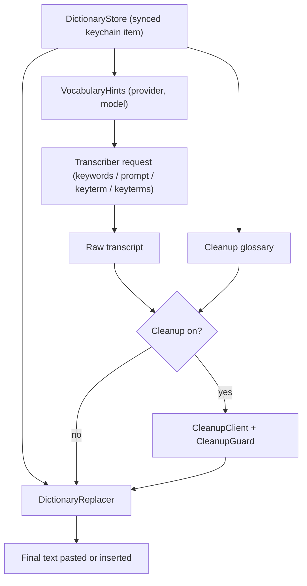
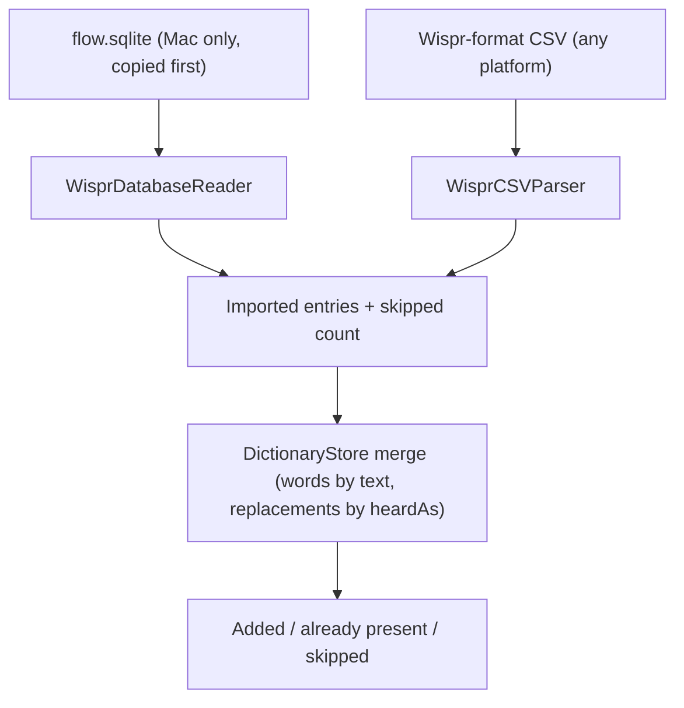

# Custom Dictionary with Wispr Flow Import - Plan

## Goal Capsule

- **Objective:** A Speak user's names, acronyms, and jargon come out spelled right on Mac, iPhone, and iPad with any provider, and someone leaving Wispr Flow starts from the dictionary they already built there instead of retyping it.
- **Means:** One synced personal dictionary that feeds provider spelling hints, the cleanup prompt, and on-device replacements (KTD1, KTD3, KTD5), filled by a Wispr Flow importer on the Mac and a CSV importer everywhere (KTD7, KTD8).
- **Authority:** Product Contract requirements win on behavior. Key Technical Decisions win on mechanism. Units cite both and override neither.
- **Stop conditions:** Stop and report if the Wispr Flow database on a real Mac has no `Dictionary` table, lacks any column KTD7 reads, or returns zero personal rows when it has live non-snippet rows. Any of these means the Mac import path (R8) needs a different design.
- **Execution profile:** Built on a Mac with Xcode 27. Package logic is unit-tested with no live network calls. Settings UI and the Wispr import are verified by hand on a Mac that has Wispr Flow data.
- **Who finishes:** Robert builds and installs; his friend runs the Wispr import on his own Mac. Nothing is published.

---

## Product Contract

### Summary

Add one personal dictionary, edited in settings and synced through iCloud Keychain with the other preferences. Every dictation uses it three ways: entries go to the chosen transcription provider as spelling hints, cleanup sees them when it is on, and "heard as → write as" fixes run on the device at the end. The Mac app imports a Wispr Flow dictionary in one click, and both platforms import Wispr-format CSV files.

### Problem Frame

Transcription models guess at words they have never seen, so product names, people's names, acronyms, and internal jargon come back misspelled ("cube cuddle" for kubectl). Speak's first plan left custom vocabulary out on purpose. The feature is now needed for a friend moving off Wispr Flow. He has a dictionary built up there over time, and having to rebuild it by hand is enough to keep him on Wispr. Wispr Flow has no export button, but on a Mac it keeps the dictionary in a local SQLite file, and its own bulk-import format is a simple CSV.

### Requirements

**Dictionary**

- R1. A dictionary entry is either a word (a term to spell exactly as written, such as "Kubernetes" or "SQL") or a replacement (a "heard as" phrase and the exact text to write instead, such as "pee are" → "PR").
- R2. The user can add, edit, delete, star, and search entries in settings on every platform.
- R3. The dictionary syncs across Mac, iPhone, and iPad through iCloud Keychain, and an edit on one device never wipes entries added on another.

**Using the dictionary during dictation**

- R4. Each dictation sends dictionary terms as spelling hints to the selected transcription provider, using that provider's own hint mechanism, when the selected model supports hints. Dictionary words go to no one else except the cleanup endpoint when cleanup is on (R6).
- R5. When the dictionary has more terms than the provider accepts, Speak sends as many as fit, highest priority first, and settings shows how many are sent to the current provider. Adding entries is never blocked.
- R6. When cleanup is on, the cleanup request includes the dictionary's preferred spellings.
- R7. Replacements run on the device after transcription and cleanup, match whole words case-insensitively, and write the replacement text exactly as stored.

**Import**

- R8. On the Mac, one action imports the user's personal Wispr Flow dictionary from Wispr's local database. Snippets, team-shared entries, and deleted entries are skipped.
- R9. On every platform, the user can import a CSV file in Wispr Flow's dictionary format: one column for a word, or two columns for misspelling and correction.
- R10. Import merges with the existing dictionary. An entry that matches an existing one is not duplicated: words match on `text`, replacements match on `heardAs`, both ignoring case, and a summary reports how many entries were added, already present, and skipped.
- R11. Speak only reads Wispr Flow's files, never writes them, and reads them only when the user starts an import.

**Failure**

- R12. A dictionary entry never makes a dictation fail. Terms a provider would reject are left out of that provider's hints.

### Key Decisions

- **Both entry kinds, not words only** (session-settled: user-approved — chosen over plain vocabulary words only: replacements are the only part that works the same on every provider and without cleanup). Governs R1, R7.
- **Import from Wispr Flow's database and from CSV** (session-settled: user-approved — chosen over CSV only: the friend should not need a manual export step). Governs R8, R9.
- **Personal entries only; snippets and team entries skipped** (session-settled: user-approved — chosen over importing snippets as text expansion, which Speak does not have). Governs R8.
- **Hint priority is starred, then most used, then newest** (session-settled: user-approved — chosen over newest-only: a long Wispr list should send the words the user actually relies on). Governs R5.
- **No learning from corrections** (session-settled: user-approved — chosen over Wispr-style auto-learn: it would require reading the text field after pasting). Governs R4, R11.

### Success Criteria

- The friend's Wispr Flow dictionary appears in Speak on his Mac after one import, and on his iPhone after iCloud sync, with no retyping.
- On each provider with a hint-capable model (OpenAI-compatible, Deepgram nova-3, ElevenLabs Scribe v2), dictating a sentence with three dictionary terms produces the stored spellings. On other models only replacements and cleanup apply.
- A dictionary of 1,000+ entries never causes a provider error.

### Scope Boundaries

- No snippets or text expansion, no auto-learning, no team dictionaries.
- No dictionary export. Speak's data is visible in settings, and CSV export can come later if someone asks.
- No per-app or per-language dictionaries; Speak is English-only.
- No import from other dictation apps' databases; CSV covers them.
- Not built: a live check that each provider still accepts the hint format. Considered because a provider format change would fail dictations, but the error already surfaces immediately on the next dictation with its cause (existing R16 of the original plan), and removing the dictionary restores dictation. Evidence that would change this: a provider rejecting hints without a clear error.

---

## Planning Contract

### Key Technical Decisions

- KTD1. **Each dictionary entry is its own synchronizable keychain item, account `dictionary:<id>`, in the shared access group.** iCloud Keychain resolves conflicts per item with the newest write winning, so one whole-dictionary blob would let a device with a stale copy erase entries added elsewhere (an import on the Mac, then an add on an iPhone that hasn't synced yet). With one item per entry, adds of different phrases on different devices are different items and both survive. The item ID is a hash of the entry's match key, so the same phrase added on two devices lands on one item and the newest write wins (user decision after review); an edit that changes what an entry matches moves it to the new key's item; an edit or delete touches only its own item, and deletes propagate as item deletions. Reading the dictionary is one `kSecMatchLimitAll` query on the account prefix. Each item holds the entry's JSON and keeps unknown fields on rewrite, following the existing KTD7 rule from the original plan (`docs/plans/2026-10-25-2102-feat-byok-dictation-app-plan.md`). Import adds one item per new entry. Pattern: `KeychainBlobStore` in `Packages/DictationCore/Sources/DictationCore/Settings/SecretStore.swift`.
- KTD2. **Entry shape:** `id`, `kind` (word or replacement), `text` (the word, or the replacement output), `heardAs` (replacements only), `starred`, `useCount`, `addedAt`. `useCount` comes only from Wispr imports; Speak never increments it, because it does not track usage. `starred` comes from Wispr imports and from the star control in settings. Manual entries start unstarred with zero uses and sort by `addedAt` until the user stars them. Decoding is lenient like `AppPreferences`, so older and newer builds read each other's items.
- KTD3. **Hint terms are every word entry's `text` plus every replacement's `text`.** The replacement output is the correct spelling the provider should lean toward; the `heardAs` side is a mishearing and is never sent. Terms are deduplicated case-insensitively and ordered by priority (KTD2). One pure function, `VocabularyHints`, takes the provider, model, and entries and returns the terms to send plus the count sent, so the pipeline and the settings footer (R5) share one answer.
- KTD4. **Per-provider hint rules (verified Oct 2026):**
  - **OpenAI-compatible, model starting with `gpt-transcribe`:** repeated multipart `keywords[]` fields. Drop terms containing `<`, `>`, CR, or LF, because the API rejects the whole request on them. Cap at 100 terms until the count limit is confirmed (Open Questions).
  - **OpenAI-compatible, any other model (Whisper on OpenAI, Groq, local servers):** one `prompt` field reading as a natural spelling list, e.g. "Vocabulary: Kubernetes, PR, Populi." Whisper keeps only the last 224 tokens of a prompt, so cap the prompt at about 600 characters, adding terms in priority order until the next would exceed it.
  - **Deepgram, model starting with `nova-3`:** repeated `keyterm` query items, percent-encoded strictly so `+`, `&`, and `=` are escaped (Foundation's `appending(queryItems:)` leaves `+` raw, which Deepgram reads as a space). The limit is 500 tokens across all terms and over-limit requests fail, so stop at an estimated 400 tokens, estimating each term as one token per 3 characters, rounded up. Other Deepgram models get no hints.
  - **ElevenLabs Scribe v2:** repeated multipart `keyterms` fields. Drop terms of 50 or more characters, more than 5 words, or containing `<>{}[]\`. Cap at 100 terms, because above 100 every request is billed at least 20 seconds, which would multiply the cost of short dictations. Keyterms add a 20% surcharge; settings says so when ElevenLabs is selected.
- KTD5. **Replacements run last, in a pure `DictionaryReplacer`, after cleanup and its guard.** Running after the guard keeps replacement changes from counting as cleanup drift. Matching is case-insensitive on whole words: a match may not touch a letter or digit on either side. Longer `heardAs` phrases are tried first so "pee are review" wins over "pee are". Output is the stored `text` exactly.
- KTD6. **Cleanup gets the dictionary as a second system message** listing preferred spellings, capped at about 2,000 characters in priority order. The user's editable prompt stays untouched, so "Reset prompt to default" keeps working and the dictionary needs no prompt-editing.
- KTD7. **Wispr Flow import reads a copy of the database.** The Mac app is not sandboxed (KTD12 of the original plan), so it reads `~/Library/Application Support/Wispr Flow/flow.sqlite` directly. When that file is missing it reports "No Wispr Flow data found on this Mac. Import a CSV instead." It opens the live database with `SQLITE_OPEN_READONLY` and uses SQLite's backup API to copy a consistent snapshot into a private temp file, then queries the snapshot and deletes it afterwards. The database is in WAL mode and Wispr may be writing, so copying the files one by one could capture an inconsistent set; the read-only backup never writes Wispr's files (R11). Query: rows from `Dictionary` where `isDeleted = 0`, `isSnippet = 0`, and `teamDictionaryId` is the all-zero personal UUID. A row with a non-empty `replacement` becomes a replacement (`heardAs` = `phrase`, `text` = `replacement`); otherwise a word (`text` = `phrase`). `isStarred` and `frequencyUsed` map to `starred` and `useCount`. Column names come from a community export script, not Wispr documentation, so the reader checks the schema first and reports "This Wispr Flow version isn't recognized. Import a CSV instead." when columns are missing.
- KTD8. **CSV import follows Wispr's documented format:** UTF-8, no header, one column for a word or two for misspelling and correction, double-quoted fields with doubled quotes, Unix or Windows line endings, surrounding spaces trimmed. Rows that are empty, have more than two non-empty columns, or have an unterminated quote are skipped and counted. The parser is pure and lives in `DictationCore`; the apps present the file picker (`fileImporter` on both platforms).

### High-Level Technical Design

How one dictation uses the dictionary:

How imports reach the store:

### Assumptions

- The friend's Wispr Flow database matches the schema in KTD7. The stop condition covers the case where it doesn't.
- iCloud Keychain handles a dictionary of about 1,000 small items. U5's two-device check confirms it.
- iCloud Keychain sync is on for the friend's devices, as Speak already requires.

---

## Implementation Units

### U1. Dictionary model and synced store

- **Goal:** Store, edit, and merge dictionary entries in a synced keychain item.
- **Requirements:** R1, R2, R3, R10, KTD1, KTD2.
- **Dependencies:** none.
- **Files:** `Packages/DictationCore/Sources/DictationCore/Dictionary/DictionaryEntry.swift`, `Packages/DictationCore/Sources/DictationCore/Dictionary/DictionaryStore.swift`, `Packages/DictationCore/Sources/DictationCore/Settings/SecretStore.swift` (a keychain store that lists, reads, writes, and deletes items by account prefix), `Packages/DictationCore/Sources/DictationCore/Settings/SettingsStore.swift` (expose the store from `.keychain()` and `.inMemory()`), `Packages/DictationCore/Tests/DictationCoreTests/DictionaryStoreTests.swift`, `Packages/DictationCore/Tests/DictationCoreTests/InMemoryBlobStore.swift`.
- **Approach:** The store sits on a small item-collection protocol with a keychain implementation and an in-memory fake, the same split as `BlobStore`. Edits are add, update by ID, delete by ID, star or unstar by ID, and merge-batch; each touches only its own items. Add and merge apply R10's match rule. Merge returns counts for R10's summary. Priority ordering lives here as one sort used by U2 and U5.
- **Test scenarios:**
  - Two stores built from snapshots of the same starting items each add a different entry; replaying both stores' writes onto one collection keeps both entries (the stale-device case).
  - Deleting by ID removes only that entry's item, and an unknown JSON field written by a "newer build" into another entry survives an edit to it.
  - Merging ["Kubernetes", "kubernetes", "PR"] into a store holding "KUBERNETES" adds only "PR" and reports 1 added, 2 already present.
  - Merging replacements "pee are" → "PR" and "P R" → "PR" adds both; merging "Pee Are" → "PR" afterwards reports it already present.
  - A word "PR" and a replacement "pee are" → "PR" are not treated as duplicates of each other.
  - Adding a word that matches an existing word is rejected as a duplicate.
  - Priority order: a starred entry with 0 uses sorts before an unstarred entry with 50 uses, which sorts before a newer unstarred entry with 0 uses.
  - An unreadable existing item makes edits throw without writing.
- **Verification:** `swift test` passes in `Packages/DictationCore`.

### U2. Provider hints

- **Goal:** Each transcription request carries the dictionary terms its provider accepts.
- **Requirements:** R4, R5, R12, KTD3, KTD4.
- **Dependencies:** U1.
- **Files:** `Packages/DictationCore/Sources/DictationCore/Dictionary/VocabularyHints.swift`, `Packages/DictationCore/Sources/DictationCore/Transcription/Transcriber.swift` (add hint terms to `TranscriptionConfig`), `Packages/DictationCore/Sources/DictationCore/Transcription/OpenAICompatibleTranscriber.swift`, `Packages/DictationCore/Sources/DictationCore/Transcription/DeepgramTranscriber.swift`, `Packages/DictationCore/Sources/DictationCore/Transcription/ElevenLabsTranscriber.swift`, `Packages/DictationCore/Sources/DictationCore/Settings/SettingsStore.swift` (`transcriptionConfig` fills hints), `Packages/DictationCore/Tests/DictationCoreTests/VocabularyHintsTests.swift`, `Packages/DictationCore/Tests/DictationCoreTests/TranscriberTests.swift`.
- **Approach:** `VocabularyHints` owns all KTD4 rules and returns terms plus the sent count. Transcribers only encode what they're given. An empty term list sends no hint field at all, so requests with an empty dictionary are byte-for-byte unchanged.
- **Test scenarios:**
  - `gpt-transcribe` with ["Kubernetes", "PR"] sends two `keywords[]` parts and no `prompt`; `whisper-large-v3-turbo` with the same terms sends one `prompt` containing both and no `keywords[]`.
  - A term "a<b" is dropped for `gpt-transcribe` while the other terms still send.
  - 300 short terms on Whisper produce a prompt under 600 characters that contains the highest-priority terms, not the newest.
  - Deepgram `nova-3` with 300 ten-character terms sends `keyterm` items whose estimated total stays at or under 400 tokens; Deepgram `nova-2` sends no `keyterm`.
  - A two-word term "pull request" reaches Deepgram as one `keyterm` value, and "C++" reaches it as `keyterm=C%2B%2B`.
  - ElevenLabs drops a 60-character term and a six-word term, and never sends more than 100 `keyterms`.
  - A replacement entry's `heardAs` ("pee are") never appears in any request; its `text` ("PR") does.
  - An empty dictionary leaves every provider's request body and URL identical to today's fixtures.
- **Verification:** `swift test` passes; existing transcriber fixtures still pass unchanged.

### U3. Replacements, cleanup glossary, and pipeline wiring

- **Goal:** Dictations apply the dictionary end to end.
- **Requirements:** R6, R7, R12, KTD5, KTD6.
- **Dependencies:** U1, U2.
- **Files:** `Packages/DictationCore/Sources/DictationCore/Dictionary/DictionaryReplacer.swift`, `Packages/DictationCore/Sources/DictationCore/Cleanup/CleanupClient.swift`, `Packages/DictationCore/Sources/DictationCore/Pipeline/DictationPipeline.swift`, `Packages/DictationCore/Tests/DictationCoreTests/DictionaryReplacerTests.swift`, `Packages/DictationCore/Tests/DictationCoreTests/PipelineTests.swift`.
- **Approach:** The pipeline reads the dictionary once per run. An unreadable dictionary item is treated as empty rather than failing the dictation (R12), unlike unreadable preferences, because no host or key depends on it. Replacement runs on whichever text the pipeline returns, raw or cleaned. Mac and iOS callers (`Apps/Mac/MacDictationController.swift`, `Apps/iOS/FlowSessionController.swift`) need no change because they already call `DictationPipeline.run`.
- **Test scenarios:**
  - "open a pee are for the fix" with "pee are" → "PR" becomes "open a PR for the fix"; "peeare" and "speer arena" are unchanged.
  - "Pee Are" at the start of a sentence still matches and is written as "PR".
  - With both "pee are" → "PR" and "pee are review" → "PR review", the input "pee are review" yields "PR review".
  - Replacement text containing regex-special characters ("C++", "$HOME") is written literally.
  - With cleanup on, the chat request carries the user's prompt unchanged plus a second system message listing dictionary spellings.
  - With cleanup on and the guard rejecting the output, the raw transcript still gets replacements applied.
  - An unreadable dictionary item still produces the transcript, with no hints sent.
- **Verification:** `swift test` passes.

### U4. Wispr Flow and CSV importers

- **Goal:** Turn a Wispr Flow database or a Wispr-format CSV into entries ready to merge.
- **Requirements:** R8, R9, R10, R11, KTD7, KTD8.
- **Dependencies:** U1.
- **Files:** `Packages/DictationCore/Sources/DictationCore/Dictionary/WisprCSVParser.swift`, `Packages/DictationCore/Sources/DictationCore/Dictionary/WisprDatabaseReader.swift`, `Packages/DictationCore/Tests/DictationCoreTests/WisprImportTests.swift`, `Packages/DictationCore/Tests/DictationCoreTests/Fixtures/wispr-dictionary.csv`.
- **Approach:** Both importers return entries plus a skipped count and never touch the store; U5 merges. The database reader takes a source URL so tests can point it at a database they build with `SQLite3`, and does the snapshot-then-open itself so the temp snapshot is always deleted, including on error.
- **Execution note:** Before finishing, run the reader against a real Wispr Flow `flow.sqlite` (the friend's, or any install with entries) and check the schema matches KTD7; this is the plan's stop condition.
- **Test scenarios:**
  - CSV `Kubernetes`, `"Whisper Flow","Wispr Flow"`, `pee are,PR,` imports one word and two replacements (the trailing comma is harmless).
  - CSV rows `a,b,c`, a blank line, and `"unterminated` are skipped and counted as 3; a quoted `"say ""hi"""` imports as `say "hi"`.
  - CRLF line endings and a UTF-8 BOM parse the same as LF without a BOM.
  - A built test database with a personal word, a personal replacement, a snippet, a team entry, and a deleted entry imports exactly the first two, with `isStarred` and `frequencyUsed` carried over.
  - A database whose `Dictionary` table lacks `replacement` fails with the "isn't recognized" error, and no temp snapshot is left behind.
  - A test database in WAL mode with rows still in its `-wal` file, held open by a second connection, imports those rows.
  - The source database file's modification date and size are unchanged after import.
- **Verification:** `swift test` passes, and the manual real-database check above succeeds.

### U5. Dictionary settings and import UI

- **Goal:** Users manage the dictionary and run imports from settings on both platforms.
- **Requirements:** R2, R5, R8, R9, R10, R11, KTD4.
- **Dependencies:** U1, U2, U4.
- **Files:** `Packages/DictationCore/Sources/DictationUI/DictionaryView.swift`, `Packages/DictationCore/Sources/DictationUI/SettingsView.swift` (a Dictionary section linking to it), `README.md`.
- **Approach:** `SettingsView` gets a Dictionary section showing the entry count, "N of M sent as hints to <provider>" from `VocabularyHints`, and a link to `DictionaryView` (navigation on iOS, a sheet on the Mac Settings window). When the selected model takes no hints, that line instead reads "This model doesn't take spelling hints; replacements still apply." `DictionaryView` has search, add, edit, a star toggle per row, swipe or context-menu delete, "Import CSV…", and, on macOS only, "Import from Wispr Flow". Rows not currently sent as hints show a secondary "Not sent" label, so a user knows to star a word they need.
  - **Add and edit:** one form on both platforms with a Word/Replacement picker, a "Write as" field, and a "Heard as" field shown only for replacements. Save stays disabled while a required field is empty after trimming. A duplicate under R10's rule shows "Already in your dictionary" inline.
  - **Results and failures:** a successful import ends in an alert with R10's counts. A failed import shows an error alert instead, using KTD7's messages for a missing or unrecognized Wispr database. A failed add, edit, star, delete, or merge shows an inline red error row like `SettingsView`'s save error and leaves the list unchanged.
  - **Footer:** dictionary words go to the chosen transcription provider with the audio and, when cleanup is on, to the cleanup endpoint with the transcript. When ElevenLabs is selected it adds the 20% keyterm surcharge. The model reloads on scene activation like `SettingsModel` does today. README's feature list gains a line on the dictionary and Wispr import.
- **Test expectation:** none in code — the logic it shows is covered in U1, U2, and U4; this unit is verified by rendering.
- **Verification:** On the Mac, run the Wispr import on a machine with Wispr Flow data and confirm the summary counts; add, edit, search, and delete an entry; confirm the hint count changes when switching provider. On iPhone, confirm the imported entries appear after sync and a CSV import works from Files. With the iPhone offline, add a word on it while adding a different word on the Mac; after both reconnect, both words are on both devices. Star a manual word and confirm its "Not sent" label clears. Capture screenshots of the Dictionary section and the import summary.

---

## Verification Contract

| Gate | Command or check | Proves |
|---|---|---|
| Package tests | `(cd Packages/DictationCore && swift test)` | U1–U4 behavior, no live network calls |
| Mac build and tests | `xcodebuild -project Speak.xcodeproj -scheme SpeakMac -destination 'platform=macOS' test` | Mac target still builds and its tests pass |
| iOS build | `xcodebuild -project Speak.xcodeproj -scheme SpeakiOS -destination 'generic/platform=iOS' build` | iOS app and keyboard still build |
| Project regen | `xcodegen generate` after adding files | New files are in the generated project |
| Live smoke | Dictate a sentence with three dictionary terms on each provider's hint-capable model | Each transcript contains all three stored spellings, with no provider error |
| Two-device sync | U5's offline add on two devices | R3: neither device's entries are lost |
| Wispr smoke | Import from a real Wispr Flow install | Stop condition and R8 |

---

## Definition of Done

- Every unit's verification passes, and the Verification Contract gates are green.
- An empty dictionary leaves every provider request unchanged (U2's last scenario).
- The real Wispr Flow import has been run once and matched the expected counts.
- README mentions the dictionary and Wispr import.
- No leftover experimental code, temp databases, or debug logging in the diff.

---

## Open Questions

- Deferred to implementation: OpenAI documents no count limit for `gpt-transcribe` `keywords[]`. Confirm with one live request of 100 and of 500 keywords, and raise the KTD4 cap if 500 succeeds.
- Deferred to implementation: confirm ElevenLabs accepts `keyterms` as repeated multipart fields (the documented examples use the SDK's list parameter).

## Sources

- Wispr Flow bulk import format: https://docs.wisprflow.ai/articles/8955301725-how-do-i-bulk-import-for-dictionary-and-snippets
- Wispr Flow local data location: https://docs.wisprflow.ai/articles/3884018196-completely-removing-wispr-flow-from-your-device
- Wispr `Dictionary` table columns (community script): https://gist.github.com/roeex5/f465ff1989a087222467a24dc85ac241
- OpenAI `keywords` and `prompt` rules: https://developers.openai.com/api/docs/guides/speech-to-text
- Deepgram keyterm limit: https://developers.deepgram.com/docs/keyterm
- ElevenLabs keyterms limits and billing: https://elevenlabs.io/docs/api-reference/speech-to-text/convert
